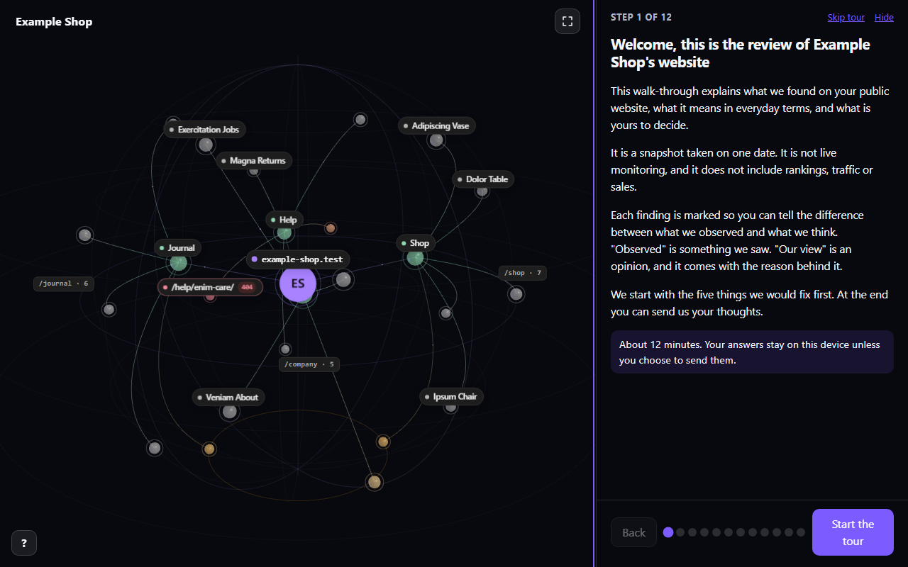
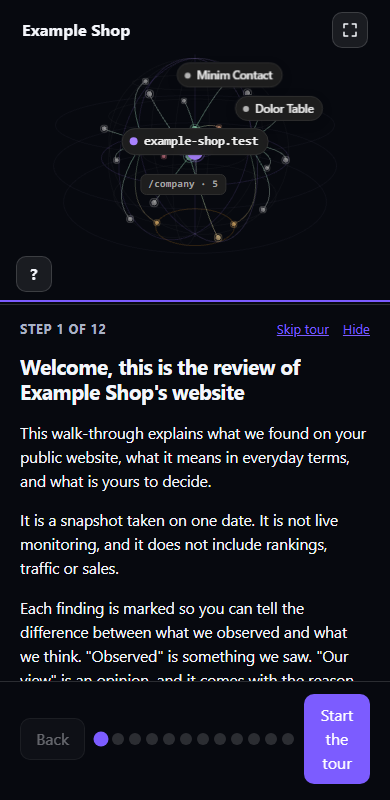
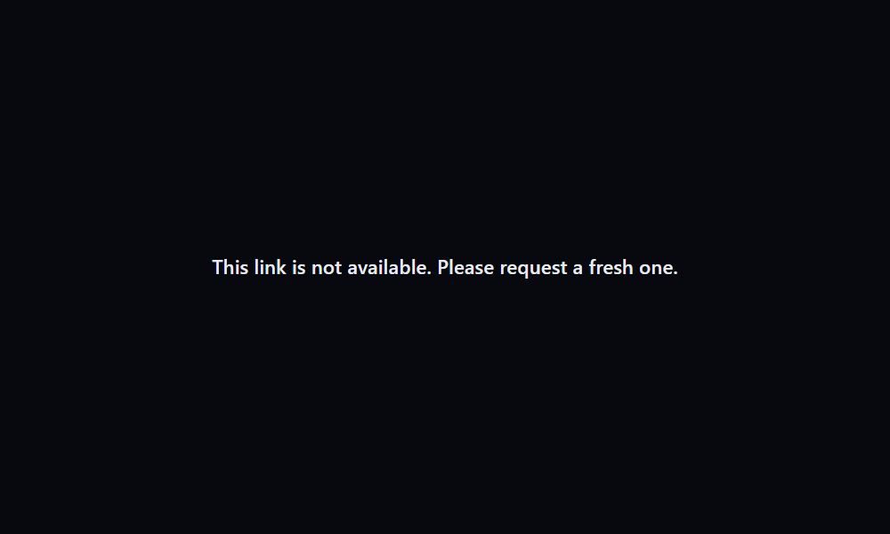

# Setup guide: from nothing to a client link

This guide takes you from an empty server to a private link you can send a client. For the click-by-click Cloudflare steps it points to
`docs/SETUP.md`. Placeholders: `audit.example.com` is your hostname and `OWNER` is the registry account that holds your image.
Use invented data until the whole path works.

## What it is

web-obs-client-report is a small service you run yourself. You review a website with [web-obs](https://github.com/AgriciDaniel/web-obs),
approve a plain-language report, and publish it. The client opens a private link and takes a guided tour of the findings on a 3D map
of their own site. There is no client login, no tracking and no analytics.

## How it works

```
Obsidian + web-obs plugin  --->  ingest (port 8081)  --->  viewer (port 8080)  --->  the client's browser
  capture, review, approve        checks the upload,         serves the report only     https://audit.example.com/r/<token>
  "Publish"                       stores the report and      to a valid link
                                  makes the link
```

- **Plugin.** You publish an approved report from Obsidian. The plugin sends one JSON file to the ingest.
- **Ingest** (optional, off until you switch it on). It checks the secret, the Cloudflare Access token and the shape of the report, stores it,
  and sends back a link. The link is shown once; the server keeps only a hash of its token.
- **Viewer.** It serves the report only to a request that carries a valid link. Anything else gets the same plain refusal.
- **Cleanup.** A daily job removes expired and revoked links and their reports.

One image runs all of it. The viewer and the ingest are two services of that image, plus the daily cleanup. Nothing publishes a port: a
Cloudflare tunnel on the same Docker network is the only way in.

## What it does for the client

- A guided tour over a 3D globe of the client's site, with every finding explained in plain terms.
- A page card when they click a page on the map.
- An optional feedback step at the end of the tour.
- A look per report (colors, two bundled fonts, a name) when the report carries one, see `docs/STYLES.md`.

The pictures below are made from invented data (a fictional shop on `example-shop.test`), served by a local run of the viewer.



On a phone the map sits above the text:



A wrong, expired or revoked link gets one plain line and nothing else:



## What you need

- A server with Docker (Portainer is used in the examples, plain `docker compose` works too).
- A Cloudflare tunnel (`cloudflared`) running in a container on that server, and a hostname on it.
- Obsidian with the [Web-Obs plugin](https://github.com/AgriciDaniel/web-obs). It captures and reviews a site and publishes the report.
- The image: use the published one if you have its address, or build your own (step 1). Building needs a checkout of this repository and Docker.
- Node 22 or newer and `openssl` on your own computer, only for the helper in step 4 and for making a secret.

## Step 1: the image

A ready-made image is published at `ghcr.io/gcollins808/web-obs-client-report:v0.1.7`. Use that address in place of `ghcr.io/OWNER/web-obs-client-report:v0.1.7`
everywhere below. Or build your own from a checkout of this repository and push it to a registry you control (replace `OWNER` with your registry account):

```
docker build -f deploy/Dockerfile -t ghcr.io/OWNER/web-obs-client-report:v0.1.7 .
docker push ghcr.io/OWNER/web-obs-client-report:v0.1.7
```

If your registry needs a login, add it in Portainer under Registries > Add registry, with a token that can only read packages.

## Step 2: the stack

Create the data volume and note the name of the Docker network your cloudflared container is on (`docker network ls`):

```
docker volume create webobs-data
```

Then paste the stack below into Portainer (Stacks, Add stack, Web editor). It is the file `deploy/VPS-STACK-tunnel-both.yml` with its
comments removed (the file keeps them, and this block is checked against it in the tests). Change `OWNER`, and change the network name
`tunnel` at the bottom to your cloudflared network. Set the values in Portainer's "Environment variables" box, never in the file.

<!-- stack:start -->
```yaml
services:
  report:
    image: ghcr.io/OWNER/web-obs-client-report:v0.1.7
    container_name: webobs-report
    restart: unless-stopped
    environment:
      WEBOBS_REPORT_BASE: ${WEBOBS_REPORT_BASE}
      TRUST_PROXY: "1"
      CLIENT_IP_HEADER: ${CLIENT_IP_HEADER:-CF-Connecting-IP}
      REPORT_SOURCE: directory
      RETENTION_DAYS: ${RETENTION_DAYS:-90}
      MAIL_MODE: ${MAIL_MODE:-outbox}
      OUTBOX_DIR: /outbox
      WEBOBS_FEEDBACK_TO: ${WEBOBS_FEEDBACK_TO:-}
      RESEND_API_KEY: ${RESEND_API_KEY:-}
      RESEND_FROM: ${RESEND_FROM:-}
    volumes:
      - webobs-data:/data:ro
    read_only: true
    tmpfs:
      - /tmp
      - /outbox:uid=1000,gid=1000
    cap_drop:
      - ALL
    security_opt:
      - no-new-privileges:true
    networks:
      - tunnel
    healthcheck:
      test: ["CMD", "node", "-e", "fetch('http://127.0.0.1:8080/healthz').then(r=>process.exit(r.ok?0:1),()=>process.exit(1))"]
      interval: 30s
      timeout: 3s
      retries: 3
      start_period: 5s

  ingest:
    image: ghcr.io/OWNER/web-obs-client-report:v0.1.7
    container_name: webobs-ingest
    restart: unless-stopped
    command: ["node", "ingest/ingest.mjs"]
    environment:
      INGEST_ENABLED: ${INGEST_ENABLED:-0}
      INGEST_SECRET: ${INGEST_SECRET:-}
      INGEST_REQUIRE_ACCESS_HEADER: ${INGEST_REQUIRE_ACCESS_HEADER:-1}
      INGEST_ACKNOWLEDGE_NO_EDGE_AUTH: ${INGEST_ACKNOWLEDGE_NO_EDGE_AUTH:-}
      CF_ACCESS_TEAM_DOMAIN: ${CF_ACCESS_TEAM_DOMAIN:-}
      CF_ACCESS_AUD: ${CF_ACCESS_AUD:-}
      WEBOBS_REPORT_BASE: ${WEBOBS_REPORT_BASE}
      TRUST_PROXY: "1"
      CLIENT_IP_HEADER: ${CLIENT_IP_HEADER:-CF-Connecting-IP}
      INGEST_REPORTS_DIR: /data/reports
      INGEST_REGISTRY_DIR: /data/registry
      INGEST_AUDIT_LOG: /data/audit/ingest.log
      INGEST_AUDIT_MAX_BYTES: ${INGEST_AUDIT_MAX_BYTES:-1048576}
      INGEST_AUDIT_KEEP: ${INGEST_AUDIT_KEEP:-3}
    volumes:
      - webobs-data:/data
    read_only: true
    tmpfs:
      - /tmp
    cap_drop:
      - ALL
    security_opt:
      - no-new-privileges:true
    networks:
      - tunnel
    healthcheck:
      test: ["CMD", "node", "-e", "fetch('http://127.0.0.1:8081/healthz').then(r=>process.exit(r.ok?0:1),()=>process.exit(1))"]
      interval: 30s
      timeout: 3s
      retries: 3
      start_period: 5s

  cleanup:
    image: ghcr.io/OWNER/web-obs-client-report:v0.1.7
    container_name: webobs-cleanup
    restart: unless-stopped
    init: true
    command: ["sh", "-c", "while true; do node tools/cleanup.mjs --reports /data/reports --registry /data/registry; sleep 86400; done"]
    volumes:
      - webobs-data:/data
    read_only: true
    tmpfs:
      - /tmp
    cap_drop:
      - ALL
    security_opt:
      - no-new-privileges:true
    network_mode: "none"
    healthcheck:
      disable: true

volumes:
  webobs-data:
    external: true

networks:
  tunnel:
    external: true
```
<!-- stack:end -->

The minimum to deploy: `WEBOBS_REPORT_BASE` = `https://audit.example.com`. Leave `INGEST_ENABLED` unset. The viewer becomes `healthy`;
the ingest shows running but `unhealthy`, which is correct while it is switched off. If you prefer plain `docker compose`, use
`deploy/docker-compose.yml` with `deploy/.env.example` copied to `deploy/.env`.

## Step 3: the tunnel and Cloudflare Access

Two routes on one hostname, in this order: path `ingest/*` to `http://ingest:8081`, then the catch-all to `http://report:8080`. A
Cloudflare Access application with a service-token policy covers `audit.example.com/ingest*` only. The viewer has no Access login.
Create the Access service token first (`docs/SETUP.md`, section 5, item 1): you need its Client ID and Client Secret in step 5, and the secret is shown once.
Details, rules for caching and robots headers, and how to read the AUD tag: `docs/SETUP.md`, sections 4 to 6. Do the Cloudflare work before step 4,
so the ingest has something to check.

## Step 4: switch the ingest on

Make a secret of at least 32 characters (`openssl rand -hex 32`) and set `INGEST_ENABLED=1`, `INGEST_SECRET`, `CF_ACCESS_TEAM_DOMAIN` and
`CF_ACCESS_AUD`, then update the stack. A wrong setting makes the ingest print one plain line that names the setting (never its value)
and exit. `node apps/server/tools/make-stack-env.mjs` can write the env file for you and makes the secret without showing it.

Check it: without the service token the ingest must be refused by Access (a login page or 403, never `ok`):
`curl -si https://audit.example.com/ingest/healthz | head -1`. With the token, the plugin's first publish (step 5) is the real test.

## Step 5: the plugin settings

In Obsidian, open Settings, then Web-Obs, and scroll to the **Client reports** section. Fill in:

1. **Publish target:** `audit.example.com` (the base address only; https is required and the plugin adds `/ingest/v1/reports`).
2. **Publish secret:** the same value as `INGEST_SECRET`. If you leave it empty, Publish asks for it once per session and keeps it in memory only.
3. **Cloudflare Access ID** and **Cloudflare Access secret:** the two values of the service token from Cloudflare Access. The plugin marks them optional because it also works without Access; with Access in front of your ingest (step 3) you need both.
4. These values are kept in Obsidian's secret storage (Obsidian 1.11.4 or later), not in the vault and not in `data.json`.
5. Optional: **Approved by** (your name, pre-filled when you publish) and **Client feedback address**.

Publish a report made from invented data first.

## Daily use

- **Publish.** Review and approve the report in the plugin, then use Publish. The link comes back
  once: copy it then. It lives for the time you chose when publishing (default 72 hours). The server keeps only a hash.
- **Share.** Send the link to the client. They open it in any browser, with no account. A wrong or expired link shows the same plain
  refusal as any unknown link.
- **Revoke.** The Studio (the report builder in this repository's viewer app, run with `npm run report:dev`) lists the links made on this computer and has Revoke link. Without the Studio:
  `curl -s -X POST -H "Authorization: Bearer $INGEST_SECRET" https://audit.example.com/ingest/v1/links/<link id>/revoke`
  (in Access mode add the two Cloudflare headers). Emergency steps with nothing but the host: `docs/SETUP.md`, "Revoking a link".
- **Cleanup.** The `cleanup` service in the stack removes expired and revoked links every day. Try it first by hand with `--dry-run`
  (`docs/SETUP.md`, step 9).
- **Check it works.** `https://audit.example.com/` shows the plain line "This link is not available. Please request a fresh one."; a published link opens the report; the same link with one
  letter changed shows the same refusal. More checks: `docs/SETUP.md`, step 8.

## Brand-forward reports: coming soon

A look per client (colors, fonts, an agency name) chosen in the Publish dialog is coming soon, through an open pull request to the Web-Obs
plugin. There is no date. This server already accepts such reports (`docs/STYLES.md`), and the plugin works without them.

## Every environment variable

Set these in Portainer's "Environment variables" box or in the env file. "Secret" means: set it on the host, never in an image, a repository
or a chat. An empty value means the default.

### Report server and ingest (set on the host)

| Name | Secret | Default | What it does |
|---|---|---|---|
| `WEBOBS_REPORT_BASE` | no | none | Public address the links start with, https, no trailing slash. Required |
| `TRUST_PROXY` | no | `0` | `1` only when the server is reachable only through your HTTPS proxy: then it reads the forwarded protocol and the client-IP header |
| `CLIENT_IP_HEADER` | no | `CF-Connecting-IP` | The header that names the caller for the rate limits. Without Cloudflare, the header your proxy sets and overwrites |
| `REQUIRE_HTTPS` | no | on | `0` allows plain http (local testing only) |
| `PORT` | no | `8080` | Port the viewer listens on |
| `RETENTION_DAYS` | no | `90` | Days a report is served at most |
| `REPORT_SOURCE` | no | `directory` | `directory` (a folder) or `https` (a fixed web address) |
| `REPORTS_DIR` | no | `/data/reports` | Folder of reports for `directory` (mount it read-only for the viewer) |
| `REGISTRY_DIR` | no | `/data/registry` | Folder of link entries, one small file of hashes per link |
| `REPORT_SOURCE_URL` | no | none | For `https`: the fixed address that serves `<report id>.json` |
| `REPORT_SOURCE_TOKEN` | yes | none | For `https`: an optional bearer token the source expects |
| `REPORT_SOURCE_TIMEOUT_MS` | no | `5000` | For `https`: how long to wait for the source |
| `DENIED_DELAY_MS` | no | `250` | Every refusal is sent after this many milliseconds, so they all look alike |
| `RATE_GENERAL_PER_MIN` | no | `60` | Requests per minute from one address |
| `RATE_BAD_TOKEN_PER_MIN` | no | `10` | Wrong-token attempts per minute from one address before it is slowed down |
| `RATE_FEEDBACK_PER_10MIN` | no | `5` | Feedback messages per link per 10 minutes |
| `APP_FILE` | no | `apps/server/app/report.html` | The built viewer page |
| `FONTS_DIR` | no | `fonts` beside `server.mjs` | The bundled fonts folder (a report's look can only name one of them) |
| `ENV_FILE` | no | `apps/server/.env` | Read the settings from another file |
| `MAIL_MODE` | no | resend if a key is set, else `outbox` | `outbox` (feedback kept in memory, lost on restart) or `resend` (emailed) |
| `OUTBOX_DIR` | no | `/data/outbox` | Folder for outbox files |
| `WEBOBS_FEEDBACK_TO` | no | none | Address that receives client feedback |
| `WEBOBS_FEEDBACK_SUBJECT` | no | "Feedback from {client} on their website review" | Subject of the feedback email; `{client}` becomes the client's name |
| `RESEND_API_KEY` | yes | none | Resend API key, only with `MAIL_MODE=resend` |
| `RESEND_FROM` | no | none | Sender address for the feedback email (verified in Resend) |

### Ingest only

| Name | Secret | Default | What it does |
|---|---|---|---|
| `INGEST_ENABLED` | no | off | `1` turns the ingest on. Anything else: it idles and answers 503 |
| `INGEST_SECRET` | yes | none | The application secret: 32 or more characters (48 without Cloudflare Access) |
| `INGEST_PORT` | no | `8081` | Port of the ingest (internal; the tunnel routes `ingest/*` to it) |
| `CF_ACCESS_TEAM_DOMAIN` | no | none | Your Zero Trust team domain, for example `yourteam.cloudflareaccess.com` |
| `CF_ACCESS_AUD` | no | none | The Access application's Audience (AUD) tag |
| `INGEST_REQUIRE_ACCESS_HEADER` | no | on | Empty or `1`: verify the Cloudflare Access token. `0` runs without it (not recommended, `docs/SETUP.md`) |
| `INGEST_ACKNOWLEDGE_NO_EDGE_AUTH` | no | none | Exactly `yes`, and only with `INGEST_REQUIRE_ACCESS_HEADER=0` |
| `INGEST_REPORTS_DIR` | no | `/data/reports` | Where the ingest writes reports (read-write for this service only) |
| `INGEST_REGISTRY_DIR` | no | `/data/registry` | Where the ingest writes link entries |
| `INGEST_AUDIT_LOG` | no | `/data/audit/ingest.log` | Audit log (ids and times only) |
| `INGEST_AUDIT_MAX_BYTES` | no | `1048576` | The audit log rotates at this size |
| `INGEST_AUDIT_KEEP` | no | `3` | How many rotated audit files stay (at most 20) |
| `INGEST_DEFAULT_HOURS` | no | `72` | Hours a new link lives when the caller does not say |
| `INGEST_MAX_HOURS` | no | `720` | The most a caller may ask for |
| `INGEST_MAX_BYTES` | no | `2097152` | Largest upload in bytes |
| `INGEST_MAX_REPORTS` | no | `1000` | Most reports held |
| `INGEST_RATE_PER_HOUR` | no | `30` | Uploads per hour per address |
| `INGEST_BAD_PER_MIN` | no | `10` | Wrong secrets per minute per address |

### Publishing from a computer (the publish command and the Studio helper)

| Name | Secret | Default | What it does |
|---|---|---|---|
| `WEBOBS_PUBLISH_TARGET` | no | none | Where a report goes: `user@host:/srv/webobs` (ssh), a folder, or an https ingest address |
| `WEBOBS_INGEST_SECRET` | yes | none | For an https target: the same value as the server's `INGEST_SECRET` |
| `CF_ACCESS_CLIENT_ID` | no | none | For an https target behind Access: the service token's Client ID |
| `CF_ACCESS_CLIENT_SECRET` | yes | none | For an https target behind Access: the service token's Client Secret |
| `WEBOBS_REPORT_TTL_HOURS` | no | `72` | How long a published link works, in hours |
| `WEBOBS_REPORT_INDEX` | no | `.report-index/index.json` | Where the local list of published links is kept (never uploaded) |
| `WEBOBS_VAULT` | no | none | The vault whose `sites/<domain>` captures the Studio can list and archive |
| `WEBOBS_HELPER_PORT` | no | `4178` | Port of the local Studio helper |
| `WEBOBS_STUDIO_ORIGINS` | no | local addresses on ports 4176, 4177 and 5176 | Comma separated list of origins the helper accepts requests from |

### Plain docker compose (`deploy/docker-compose.yml` and `deploy/.env`)

| Name | Secret | Default | What it does |
|---|---|---|---|
| `WEBOBS_IMAGE` | no | `ghcr.io/OWNER/web-obs-client-report:v0.1.7` | The image to run (replace `OWNER`, or point at your own registry) |
| `TUNNEL_NETWORK` | no | `tunnel` | The Docker network your cloudflared container is on (`docker network ls`) |
| `COMPOSE_PROFILES` | no | empty (viewer only) | `ingest`, `cleanup` or `ingest,cleanup` to start the optional services |

### Build and development

| Name | Secret | Default | What it does |
|---|---|---|---|
| `WEBOBS_BRAND` | no | on | `off` builds the viewer with its neutral look and ignores any brand folder |
| `WEBOBS_BRAND_DIR` | no | `apps/viewer/brand` | A folder holding `brand.json` (and fonts) to build an agency brand into the viewer, see `apps/viewer/brand/README.md` |
| `WEBOBS_BRAND_STRICT` | no | `0` | `1` makes an invalid brand fail the build instead of falling back to the neutral look (also a Docker build argument) |
| `WEBOBS_CLIENT_NAMES_FILE` | no | `.client-names` | File of client-name patterns, one per line, for `npm run check:client-data`. Keep it out of the repository |
| `DIR` | no | `dist-report` | Development preview server (`npm run report:serve`): the folder of the built viewer |
| `PREVIEW_REPORTS_DIR` | no | `dev-volume/reports` | Development preview server: the folder of reports it serves |

The same names, with a short comment each, are in `.env.example` and `deploy/.env.example`.

## Where to go next

- `docs/SETUP.md`: the click-by-click Cloudflare and Portainer steps, verification, cleanup, teardown.
- `docs/INGEST-SECURITY.md` and `SECURITY.md`: what the ingest accepts and refuses.
- `docs/TROUBLESHOOTING.md` and `scripts/webobs-doctor.sh`: when something is refused.
- `docs/STYLES.md`: a look carried by a report.
- `docs/ARCHITECTURE.md` and `docs/CLIENT-REPORT-CONTRACT.md`: how it is built and what a report may contain.
